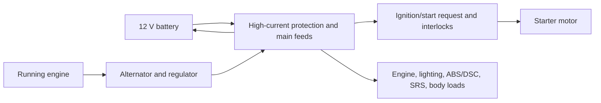
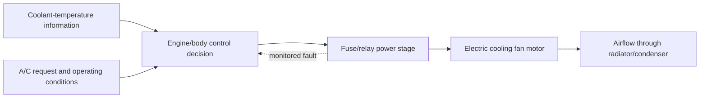
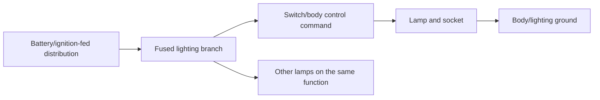
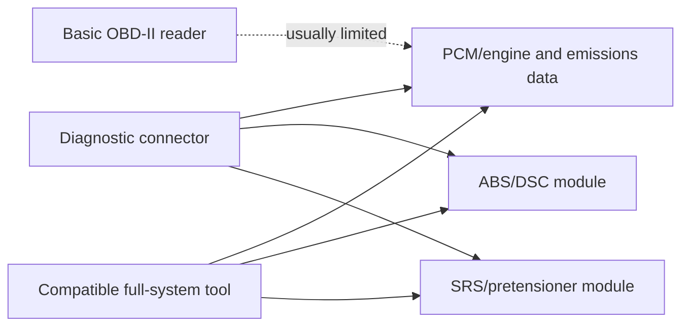

# Mazda MX-5 NC (2006–2015): electrical and diagnostic research note

This note is an original, practical outline for **The Miata Bible**. It describes system relationships and safe diagnostic logic without reproducing Mazda wiring diagrams, proprietary connector pinouts, or factory-manual text. A vehicle-specific wiring diagram, service information, and scan-tool coverage chart are still required for component-level repair.

## 1. Generation facts and caveats

The NC is the third-generation MX-5, sold in the United States from model year 2006 through 2015. For electrical diagnosis, it is more useful to think in three working groups than to treat every NC as identical:

- **NC1, approximately 2006–2008:** the completely new platform introduced modern engine control, anti-lock braking availability that varied by market/trim, optional Dynamic Stability Control (DSC), and—starting in 2007—the Power Retractable Hard Top (PRHT). A 2006 Canadian base car is an important exception to the otherwise broad “all NCs have ABS” shorthand. [1]
- **NC2, approximately 2009–2012:** facelifted cars received engine and chassis revisions. The changes matter when comparing scan data, control-unit behavior, and parts, even where the driver-facing warning lamps look similar. [1]
- **NC3, 2013–2015:** a second facelift. DSC became standard in the cited U.S. year-by-year account, and the engine-control calibration and brake-booster details changed. Do not assume an NC1 ABS/DSC configuration, fuse assignment, or module part number applies to an NC3. [1]

The safest identification method is the VIN, market, model year, transmission, trim, body style, and equipment list. Fuse labels and ratings can vary with market and options such as PRHT, fog lamps, headlamp washers, heated seats, automatic transmission, DSC, and emissions equipment. Use the label in that vehicle’s fuse-box cover and the correct owner information before substituting a fuse.

Mazda owner information presents two fuse areas: a cabin/left-side block and an under-bonnet block. The published panel description includes dedicated protection for engine control, headlights, tail/position/number-plate lamps, hazard/indicators, ABS/DSC, SRS, and cooling-fan circuits. It also warns that the MAIN fuse is a high-current device not intended for casual owner replacement. [2] The practical strategy is therefore **protect the feed first, then the branch**: inspect the correct block, preserve the original amperage, and find the cause of a repeat failure rather than installing a larger fuse.

### Starting and charging behavior

The starter is not only a high-current motor. The start request is gated by the vehicle’s interlocks: a manual-transmission car needs the clutch depressed, while an automatic requires Park or Neutral. Early NCs with Advanced Keyless Entry also add key recognition and an immobilizer condition. Mazda cautions against cranking for more than 10 seconds at a time and recommends a pause before another attempt because extended cranking heats the starter and drains the battery. [3]

A no-crank complaint and a crank-but-no-start complaint should be separated immediately. No-crank diagnosis begins with battery state, terminal/ground integrity, the interlock, and starter control. Crank-but-no-start diagnosis moves toward engine-management inputs, fuel, ignition, immobilizer authorization, and stored data rather than repeatedly replacing the starter.

The charging warning lamp is a system-level alarm, not proof that the alternator alone is defective. Mazda states that illumination while driving indicates a charging-system or alternator fault and warns that continued driving can end with an unexpected stall. [4] A weak battery or poor ground can also create misleading ABS/DSC warnings during a jump-start or low-voltage event; Mazda specifically notes that an ABS lamp may appear after jump-starting a weak battery and may clear after the battery is properly recharged. [5]

### Grounds and voltage drop

The NC’s compact engine bay and exposed under-bonnet connections make grounds a high-value inspection point. A ground can look tight yet fail under starter or fan load because of corrosion between terminal faces, a damaged cable, or a loose body/engine connection. DENSO’s general charging procedure recommends visual inspection, a battery load test, belt inspection, cable inspection, and separate positive- and negative-side voltage-drop tests. It gives 0.2 V or less as a useful charging-circuit target and recommends checking alternator output at roughly 2,000 rpm with electrical loads applied, while deferring final limits to the vehicle specification. [6]

### Lighting and cooling-fan control

Lighting faults should be divided into a single lamp, one side, one function, or a whole shared feed. The fuse panel documentation identifies separate headlamp left/right protection and shared tail, hazard, and related lighting branches. [2] A dark lamp is not automatically a bulb: check the bulb/socket, ground, connector, switch command, fuse, and power feed in that order appropriate to the symptom.

The electric cooling fan is a high-current, relay/fuse-fed load that may start unexpectedly. Mazda’s maintenance warnings tell the technician to keep hands, tools, and clothing clear and to confirm the fan is not running before working near it. [7] A fan complaint therefore needs two distinct questions: does the motor run when commanded, and does the control system command it for the observed coolant/air-conditioning condition? Do not “prove” a fan circuit by jumping unknown terminals or bypassing its protection.

### ABS, DSC, and airbag cautions

A basic OBD-II reader is primarily an emissions/engine tool. A reputable scan-tool reference notes that not all OBD-II scanners can access ABS, SRS (airbag), transmission, or other manufacturer-specific modules; full-system capability and year/make/model coverage must be checked before buying or borrowing a tool. [8] For an NC, record which module a code came from, whether it is current or historical, and the vehicle voltage at the time. Do not call an engine-code-only scan a “full vehicle scan.”

Mazda says an ABS warning lamp that stays on means the ABS control unit has detected a fault; base braking remains, but ABS-related functions may not. If the ABS and brake-system warning lamps are on together, Mazda warns against driving and calls for towing/inspection because rear-wheel lock behavior can change. [5] DSC-equipped cars add stability/brake-assist functions and may illuminate several warnings from one low-voltage, wheel-speed, steering-angle, or communication problem.

The SRS/seat-belt-pretensioner lamp is a safety-system status indicator. Mazda’s owner information says a lamp that stays on, flashes continuously, or fails to illuminate at key-on indicates a fault and warns that the system may not work in a crash. It also explicitly warns against self-servicing or tampering with airbag/pretensioner systems. [9] Keep ordinary multimeter probes, test lights, powered test leads, and improvised resistors out of yellow SRS connectors and initiator circuits. Treat an SRS fault as a scan-and-repair decision for a trained technician, not a lamp-reset exercise.

## 2. Diagnostic procedures

### Procedure A — No-crank or intermittent crank

**Symptom.** The key/start request produces no crank, a single click, repeated clicks, or an intermittent starter response.

**Safety.** Park securely, set the parking brake, select Neutral or Park as appropriate, and keep hands clear of belts and fans. If testing at the starter, prevent an unintended start and follow the vehicle-specific service procedure.

**Tools.** Digital multimeter, battery tester or load tester, insulated hand tools, test light only on non-SRS circuits, and a scan tool if warning lamps or immobilizer symptoms are present.

**Steps and tests.**

1. Confirm the symptom and check the instrument cluster at key-on. Note whether the cluster is dim, resets, or shows a key/immobilizer warning.
2. Inspect battery terminals, the negative cable, engine/body grounds, and the high-current fuse/fusible-link area. Clean and tighten only after the ignition is off and the battery is handled safely.
3. Measure resting battery voltage, then observe the voltage during a brief crank request. A large collapse points toward a discharged/failed battery or high-resistance connection; a normal battery with no starter response moves the investigation toward interlocks, control, relay, cable, or starter.
4. Verify the manual clutch switch or automatic Park/Neutral condition. Try Neutral only where safe and appropriate; do not defeat an interlock as a repair.
5. If the control side is commanded, measure voltage at the starter feed/control circuit using the model-appropriate service information. A voltage-drop test under load is more useful than an unloaded continuity beep.

**Verification.** The car should crank repeatedly at normal speed with no cluster reset, and the original symptom should not return after heat soak or several start cycles. If it cranks normally but does not fire, stop calling it a starter fault and begin engine-management diagnosis.

**Common mistakes.** Replacing a starter before testing the battery and grounds; holding START continuously; confusing immobilizer/key authorization with a dead starter; using a test light on SRS wiring; and assuming all NC trims share the same start-control hardware.

### Procedure B — Charging warning lamp, dimming lights, or repeated dead battery

**Symptom.** Charging lamp illuminates while driving, the battery repeatedly discharges, lights change brightness with rpm, or the car stalls after a short drive.

**Safety.** Do not remove a battery cable with the engine running. Keep clear of the belt and fan. Ventilate around a conventional battery and avoid sparks.

**Tools.** Digital multimeter, battery load tester, clamp ammeter if available, belt inspection light, and an appropriate scan tool for low-voltage history.

**Steps and tests.**

1. Inspect battery age/condition, terminal tightness, ground connections, alternator belt condition/tension, the charge cable, and the relevant high-current fuse/fusible link.
2. Test the battery at rest and under load before condemning the alternator.
3. With the engine running, measure voltage at the battery and alternator output point if safely accessible. At about 2,000 rpm, repeat with headlights, blower, and defogger loaded. DENSO’s generic reference uses 13–15 V as a broad output check and 0.2 V or less for each side of the charging-circuit voltage drop; use the NC specification for the final pass/fail decision. [6]
4. For the positive drop, measure between alternator output and battery positive while loaded. For the negative drop, measure between alternator case/ground and battery negative while loaded. A high reading localizes resistance without guessing at a part.
5. Scan for low-voltage-related codes in the PCM, ABS/DSC, and other accessible modules, recording freeze-frame or event voltage where available.

**Verification.** The charge lamp stays off after start, loaded voltage is stable within the vehicle specification, voltage drops are low, and the battery passes a retest after charging. Clear only confirmed, repair-related codes and road-test while monitoring voltage.

**Common mistakes.** Using a single 12 V reading as proof of alternator health; replacing the alternator without checking the belt, fuse, and grounds; relying on a jump-start to “fix” the cause; and treating secondary ABS/DSC codes as independent failures before correcting low voltage.

### Procedure C — Headlamp, tail-lamp, hazard, or turn-signal fault

**Symptom.** One lamp is dark, one side is dark, a function fails intermittently, or several lamps fail together.

**Safety.** Switch ignition and lamps off before opening fuse covers or changing a bulb. Allow hot bulbs to cool. Do not install a higher-rated fuse.

**Tools.** Correct replacement bulb, fuse puller, digital multimeter or fused test probe, contact-cleaning supplies, and the vehicle’s exact fuse-panel legend.

**Steps and tests.**

1. Classify the failure: single bulb, one side, one switch function, or multiple unrelated lamps.
2. Check the bulb filament and socket for heat damage, corrosion, loose tension, or water entry.
3. Check the applicable cabin and under-bonnet fuse against the exact model-year/market legend. Mazda’s published panel data shows separate left/right headlamp protection and distinct tail and hazard/indicator branches, but the car’s own label takes precedence. [2]
4. With the command on, test for power at the socket and test the ground side under load. If power is absent, work backward through the fuse, relay/switch command, connector, and feed. If power and ground are present, the bulb/socket is the likely local fault.
5. For an intermittent fault, flex the harness only gently while monitoring the circuit, and inspect body/lamphouse grounds and connector seals.

**Verification.** Confirm correct beam/indicator operation, hazard operation, brake/tail separation, and no blown fuse after a complete lighting check. Repair the cause of a repeat fuse opening before returning the vehicle to service.

**Common mistakes.** Swapping a fuse for a larger one; checking continuity without load; assuming a shared ground from a wiring diagram for another trim; and overlooking trailer/accessory wiring or water intrusion.

### Procedure D — Cooling fan not running, running constantly, or overheating in traffic

**Symptom.** Temperature rises at idle, the fan never runs, the fan runs from cold, or an A/C/fan-related code is stored.

**Safety.** Assume the fan can start with the ignition off. Keep hands and tools away from the fan and belts. Never open a hot cooling system. Do not use an improvised jumper in an unknown relay socket.

**Tools.** Scan tool with live data and output-test capability where supported, digital multimeter, infrared thermometer, fuse/relay legend, and cooling-system pressure/temperature equipment only when trained.

**Steps and tests.**

1. Verify coolant level and obvious leaks only when cold; confirm the temperature gauge behavior and whether the A/C request changes fan behavior.
2. Inspect the fan fuses, relay area, connector, harness, and motor for heat damage. Mazda’s fuse description identifies dedicated fan protection, including FAN1 and FAN2 entries in the published panel data. [2]
3. Use scan data to compare reported coolant temperature with an independent temperature observation. A plausible reported temperature with no fan command suggests control/output trouble; an implausible reading suggests sensor, wiring, or reference trouble.
4. If the tool supports it and the procedure is approved for the specific car, command the fan and observe current draw, motor speed, and voltage at the motor. Otherwise test power and ground under a known-safe manufacturer procedure.
5. If the fan runs constantly, separate a fail-safe command, stuck relay, shorted control, incorrect sensor signal, and A/C request from a mechanically failed motor.

**Verification.** The fan responds to the appropriate command/temperature condition, the engine reaches and holds normal operating temperature, A/C operation does not cause abnormal overheating, and no fan-control code returns.

**Common mistakes.** Testing only by spinning the blades by hand; replacing the motor without checking the feed and ground; trusting the dash gauge as a precise temperature instrument; ignoring a low coolant/leak problem; and working near a fan because the key is removed.

### Procedure E — ABS/DSC warning lamp or post-jump-start warning

**Symptom.** ABS, DSC/traction, or brake warning lamps remain on, especially after a weak-battery event, wheel work, or jump-start.

**Safety.** If ABS and the red brake-system warning are on together, do not road-test the car; Mazda calls for towing/inspection. [5] Brake-system diagnosis is safety-critical.

**Tools.** Full-system scan tool with confirmed NC coverage, battery charger/tester, multimeter, wheel chocks, and service information for sensor and steering-angle procedures.

**Steps and tests.**

1. Record all warning lamps and the sequence in which they appear. Check battery voltage and charging first.
2. Scan the ABS/DSC module, not only the PCM. Confirm the tool can read the module and identify each code’s status and data.
3. Inspect wheel-speed sensor wiring, connectors, tone/reluctor areas, wheel bearing play, tire-size consistency, and obvious harness damage without probing SRS circuits.
4. Compare live wheel-speed data during a controlled, safe roll if the tool and conditions permit. A single dropout or implausible speed is more actionable than simply clearing the lamp.
5. After correcting the root cause, perform only the required calibration or drive cycle for that VIN/equipment. Do not assume a battery disconnect is a calibration procedure.

**Verification.** The warning lamps complete their normal key-on self-check and go out after the fault is repaired; a road test confirms consistent wheel-speed data and normal braking behavior.

**Common mistakes.** Calling a generic engine scan “clear”; replacing an ABS module before checking voltage and wheel-speed wiring; driving with both ABS and brake lamps illuminated; and clearing codes before recording freeze-frame/data.

### Procedure F — Airbag/pretensioner lamp

**Symptom.** The SRS lamp stays on, flashes, or does not illuminate at key-on.

**Safety.** Do not probe, power, short, substitute, or ohm yellow SRS connectors, airbag initiators, pretensioners, crash sensors, or occupant-classification circuits. Mazda warns that self-servicing can accidentally activate or disable the system. [9]

**Tools.** A scan tool with confirmed SRS capability and a trained technician using the vehicle-specific SRS procedure. A battery charger may be useful for stable system voltage, but it is not a reason to bypass SRS precautions.

**Steps and tests.**

1. Observe the key-on lamp behavior and document recent battery work, seat movement, collision history, water intrusion, or connector disturbance.
2. Verify system voltage and inspect only external, accessible damage without disconnecting SRS components casually.
3. Read SRS codes with a compatible full-system tool. Record the exact module, code state, and data before clearing anything.
4. Follow the model-specific repair and post-repair confirmation procedure. If the fault involves an airbag, pretensioner, crash sensor, occupant sensor, or SRS wiring, refer the work to qualified service.

**Verification.** The lamp performs the normal key-on check and extinguishes, the SRS module reports no current fault, and no safety-system work is returned to service based only on a cleared lamp.

**Common mistakes.** Using a generic code reader that cannot access SRS; probing an initiator with an ordinary meter; unplugging a seat connector with the battery connected; and assuming a lamp reset proves the airbags are ready.

## 3. Simplified circuit descriptions for abstract diagrams

These are intentionally conceptual. They are suitable for an abstract diagram, not as a wiring or pinout substitute.

### A. Start and charge energy path

The battery supplies the high-current start event and stabilizes the vehicle bus. Once the engine runs, the alternator replenishes the battery and feeds loads through protected distribution. A poor ground or feed can therefore create several unrelated-looking symptoms at once.

### B. Cooling-fan control loop

The diagram separates **command logic** from **motor power**. A fan that does not run can fail in either side; a fan that runs constantly can have a control-input, relay, or motor-power fault. The protection and relay arrangement must be confirmed for the exact NC configuration.

### C. Lighting branch strategy

Use the symptom pattern to decide whether to start at the lamp/socket, the shared fuse/command, or the ground. One dark lamp suggests a local branch; several lamps failing together suggests a common feed, fuse, relay, command, or ground.

### D. Scan-tool scope and safety modules

The connector is an access point, not a guarantee that every module is readable. Tool capability, software coverage, vehicle equipment, and the code’s originating module must all be recorded.

## References

[1]: https://www.onallcylinders.com/2025/02/21/2006-15-mazda-mx-5-miata-nc-buyers-guide-year-by-year-changes/ "2006–15 Mazda MX-5 Miata NC Buyer’s Guide: Year-by-Year Changes"
[2]: https://owners-manual.mazda.com/gen/en/mx-5/mx-5_8gg1ee17j/contents/07031602.html "Mazda MX-5 Owner’s Manual: Fuse Panel Description"
[3]: https://www.mazdausa.com/siteassets/pdf/owners-optimized/2006/mx5-miata/2006-mx-5-miata-owners-manual.pdf "2006 Mazda MX-5 Owner’s Manual"
[4]: https://www.mazdausa.com/siteassets/pdf/owners-optimized/2006/mx5-miata/2006-mx-5-miata-owners-manual.pdf "2006 Mazda MX-5 Owner’s Manual — Charging System Warning"
[5]: https://www.mazdausa.com/siteassets/pdf/owners-optimized/2012/mx5-miata/2012-mx-5-owners-manual.pdf "2012 Mazda MX-5 Owner’s Manual — ABS and Brake Warnings"
[6]: https://www.densoautoparts.com/reference-charging-system-troubleshooting/ "DENSO Charging System Troubleshooting"
[7]: https://www.mazdausa.com/siteassets/pdf/owners-optimized/2007/mx5-miata/2007-mx-5-owners-manual.pdf "2007 Mazda MX-5 Owner’s Manual — Electrical Fan Safety"
[8]: https://www.innova.com/collections/mazda-mx-5-miata "Innova Mazda MX-5 Miata OBD2 Scanner Coverage and Limitations"
[9]: https://www.mazdausa.com/siteassets/pdf/owners-optimized/2012/mx5-miata/2012-mx-5-owners-manual.pdf "2012 Mazda MX-5 Owner’s Manual — SRS and Pretensioner Warnings"
