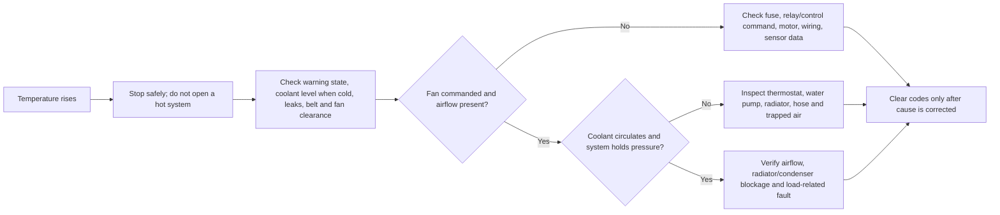
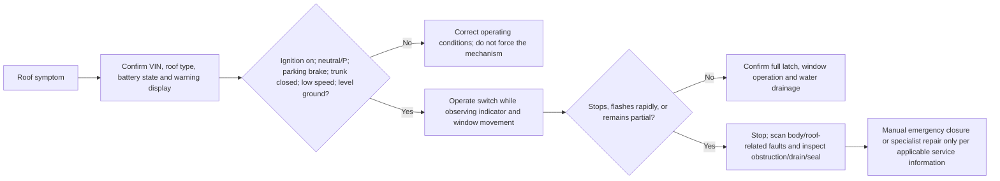
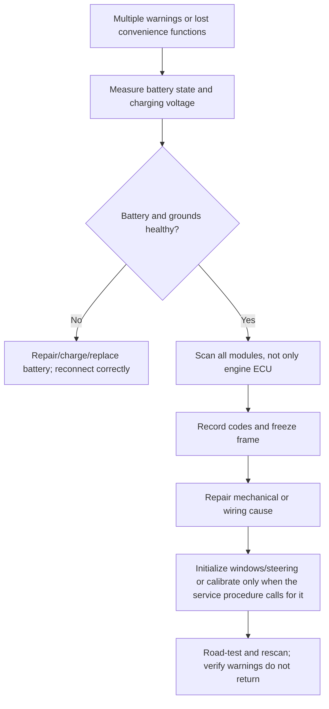

# Mazda MX-5 ND Mechanical Research Note (2016–present)

This note is an original field-reference outline for the fourth-generation MX-5 (ND), not a reproduction of Mazda workshop-manual prose, torque tables, wiring diagrams, or illustrations. Exact fastener torque, fluid capacity, calibration, and software procedures remain VIN-, market-, transmission-, and equipment-specific; confirm them in the applicable Mazda service information before performing work.

## 1. Generation facts and caveats

### ND1: 2016–2018 (market timing varies)

The launch ND is the lightest and mechanically simplest branch, with the 1.5- or 2.0-liter Skyactiv-G family depending on market. North-American 2016–2018 2.0-liter cars are the important gearbox caveat: early six-speed manuals developed a documented pattern of hard use-related second-, third-, and fourth-gear failures. Mazda issued transmission-replacement policy/technical guidance during the warranty era, and the gearbox received multiple internal revisions. A symptom such as a 2–3 crunch, gear pop-out, metallic debris on the magnetic plug, or a gear that suddenly disappears should not be “fixed” by endlessly adjusting the clutch. Diagnose the gearbox and check VIN history first. [1] [2]

Early soft-top suspension tuning is also a caveat. The ND’s short-travel suspension can reach its bump stops sooner than an owner expects, especially after lowering springs or aggressive ride-height changes. A car that feels nervous, skips over bumps, or shows abrupt oversteer may have inadequate bump travel, incorrect damper/spring pairing, or bushing preload rather than a simple alignment problem. Measure ride height and inspect bump-stop engagement before chasing toe settings. Independent competition guidance treats ND alignment and rake differently from earlier Miatas, which is a useful cross-check but not a substitute for the owner’s market-specific specification. [3]

### ND2: 2019–2023 (approximately)

The 2019 update brought the higher-output 2.0-liter engine in markets that previously used the lower-output version, a higher redline, revised engine calibration, and driveline refinements. Independent technical reporting identifies a dual-mass flywheel and revised shift behavior as important reasons that ordinary ND2 transmission warranty claims fell toward normal levels, although failures did not become impossible. Treat an ND2 as improved, not failure-proof, particularly if modified, tracked, or fitted with excess power. [2]

The ND2 also introduced or expanded electronic and ergonomic changes by trim and market. Do not assume that a warning light, steering behavior, infotainment symptom, or roof/window interaction is identical to an ND1. Battery disconnection can disturb power-window auto functions, and low voltage can create misleading multi-system warnings. Restore battery health and initialize affected functions before condemning a module. [4]

### ND3: 2024–present (market naming varies)

The 2024 refresh is commonly called ND3, but nomenclature and equipment differ by market. The major service implication is a more extensively revised electrical/electronic platform and additional driver-assistance features on some trims. An independent road comparison reports a new infotainment/electrical platform, new displays and USB-C behavior, and features such as camera-based sign recognition and radar cruise on the tested Canadian car; those features are not universal to every ND3. Diagnose by VIN and equipment, not by internet shorthand. [5]

The 2024 update also changed lighting, steering feel, software, and limited-slip/traction-control behavior by specification. A calibration or sensor fault can present as a chassis complaint. Before replacing suspension or steering parts, scan all relevant modules, record freeze-frame data, check tire pressures and alignment, and determine whether the symptom is mechanical, electrical, or a normal characteristic of the installed control strategy.

### Shared ND architecture and service boundaries

All ND variants combine a compact front-engine/rear-drive layout, independent suspension, a propeller shaft and rear differential, four-wheel disc brakes, electric power steering, and a high level of networked control. The mechanical systems are accessible, but the electronic systems are not isolated: battery voltage, wheel-speed signals, steering-angle data, brake/ABS information, roof/window interlocks, and body-control logic can interact.

Mazda’s scheduled-maintenance information calls for recurring inspection of cooling-system condition, battery, brake lines and discs, parking brake, steering linkages, suspension/ball joints/wheel bearings, driveshaft boots, chassis/body fasteners, exhaust/heat shields, tires, and body corrosion. It also specifies coolant replacement intervals by market and warns against using an incorrect coolant type; for the referenced owner information, FL-22 is the intended coolant family. Never transfer an interval from one market or model year to another without checking the car’s manual. [6]

Soft-top and RF cars are not interchangeable for body-water diagnosis. The soft top has a drain-filter service point and fabric/seam vulnerabilities. The RF adds powered roof motors, position/interlock logic, hardtop drainage outlets, moving links, and window coordination. A water leak, roof stop, or window drop problem must be approached as a body-and-electrical system, not only as a seal problem. [4] [7]

### Original simplified system flows

The following are conceptual service maps, not factory schematics.

## 2. Repair and inspection procedures

### Procedure 1 — Cooling-system triage and coolant-level verification

**Symptom.** Temperature warning, coolant smell, level falling, heater output changing, or overheating in traffic/load.

**Safety.** Park safely, shut down, keep hands clear of fans and belts, and never remove a pressure cap while hot. Mazda warns that moving fans and incorrect jump-start lead routing can injure; treat the fan as live until proven otherwise. [4]

**Tools.** Flashlight, gloves/eye protection, clean inspection tray, cooling-system pressure tester appropriate to the vehicle, scan tool with live temperature data, and the correct coolant.

**Steps.** Let the engine cool completely. Inspect the reservoir and visible hose/radiator/water-pump areas for wetness or dried residue. Check the cold level against the marked range. Inspect radiator/condenser fins for packed debris and confirm the fan shroud is intact. If level is low, find the leak before topping up repeatedly. Use the specified coolant family; Mazda’s maintenance information warns that the wrong coolant can damage the engine/cooling system. [6]

**Tests.** Pressure-test only with the correct adapter and a cold system. Compare scan-tool temperature rise with gauge behavior and fan command. If the fan never runs when commanded, branch to power, ground, control, motor, and sensor diagnosis rather than replacing the thermostat first.

**Verification.** After repair, bleed/fill using the vehicle-specific procedure, warm to operating temperature, confirm stable level after cool-down, and road-test under the condition that caused the symptom. Recheck for leaks.

**Common mistakes.** Assuming a normal-looking dash gauge proves normal temperature; opening the cap hot; mixing unknown coolant; bypassing the fan with an unfused jumper; and fitting a larger radiator before proving the actual fault.

### Procedure 2 — Engine oil, accessory belt, and front-of-engine leak inspection

**Symptom.** Oil smell, belt chirp, visible oil/coolant residue, charging fluctuation, or unexplained low oil level.

**Safety.** Keep clothing and tools away from rotating parts. Support the hood securely and keep the ignition off during static inspection.

**Tools.** Inspection light, clean dipstick cloth, mirror, UV dye only if compatible with the fluid, and scan tool for charging/engine data.

**Steps.** Inspect oil level on level ground after the specified wait period. Look around the filter, drain area, front cover, crank seal area, belt path, and coolant-pump region. Check belt ribs for glazing, cracks, contamination, or misalignment. Do not mistake assembly residue or spilled oil for an active leak; clean first, then recheck.

**Tests.** With the engine off, rotate/inspect only as allowed by the service procedure. With the engine running, observe from a safe distance for belt tracking and charging behavior. If the belt is contaminated or frayed, stop driving until corrected.

**Verification.** Confirm the oil level, charging voltage, belt tracking, and absence of fresh residue after a warm road-test. Record the fluid type and service date.

**Common mistakes.** Overfilling; using the dipstick on an incline; spraying degreaser into electrical connectors; replacing a belt without finding the pulley misalignment or leak; and treating a charging warning as a battery-only issue.

### Procedure 3 — Manual-transmission symptom screen and fluid/debris check

**Symptom.** Crunching or lockout during 2–3/3–4 shifts, gear pop-out, whining, vibration, or a gear that no longer engages.

**Safety.** Use a lift or stands rated for the car, keep the car level for fluid checks, and never run a driveline with personnel under an unsecured vehicle.

**Tools.** Scan tool if transmission-related codes are present, borescope/inspection light, drain pan, magnet inspection method, and the VIN-specific fluid specification.

**Steps.** Road-test only if the car can be operated safely. Separate clutch-release symptoms from gear engagement: note whether the fault changes with engine speed, clutch pedal position, temperature, and shift direction. Check for leaks and damage. If draining fluid, inspect the plug magnet and fluid for abnormal metallic fragments. Early ND1 gearbox failures are a known caveat; a hard shift is not automatically a clutch adjustment problem. [2]

**Tests.** With the engine off, check static gear selection. With the engine running, compare engagement in neutral, reverse, and the affected gear without forcing the lever. Use scan data where available, but do not expect a scan tool to detect every mechanical gear failure.

**Verification.** After a confirmed repair or replacement, verify every gear cold and hot, check for leaks, and use a measured break-in road-test appropriate to the replacement unit. Reinspect fluid and mount/propeller-shaft fasteners if the symptom persists.

**Common mistakes.** Continuing track use after metal appears; forcing a gear; blaming synchros before checking clutch release; installing an unspecified fluid; and assuming ND2/ND3 revisions make an abused or modified transmission immune.

### Procedure 4 — Clutch-release and hydraulic diagnosis

**Symptom.** Clutch drag, difficulty selecting reverse, engagement near the floor/top, slipping under load, or judder.

**Safety.** Secure the car against movement; keep hands clear of the rotating driveline. Brake fluid damages paint and absorbs moisture.

**Tools.** Light, catch bottle and hose, fluid-condition tester if available, pedal observation aid, and VIN-specific clutch/bleeding information.

**Steps.** Inspect reservoir level and fluid condition, line/connection areas, master-cylinder pushrod region, and slave-cylinder area for leakage. Check pedal free movement and whether the release point changes after pumping. Distinguish slip (engine speed rises without matching road speed) from drag (gear selection difficult with pedal down) and judder (engagement vibration).

**Tests.** With the engine off, select gears. With the engine idling and clutch fully depressed, test reverse engagement without force. Check whether pumping the pedal temporarily changes the fault; this suggests hydraulic air/leakage but does not prove the component at fault.

**Verification.** Bleed using the correct sequence and fluid, confirm a firm consistent pedal, clean engagement, quiet release, and no fluid loss. If the symptom remains, inspect clutch/flywheel and transmission input support rather than continuing to bleed.

**Common mistakes.** Using the wrong reservoir; spilling fluid on painted parts; diagnosing a failing gearbox as clutch drag; and replacing the clutch without checking the hydraulic leak that caused it.

### Procedure 5 — Propeller shaft, differential, mounts, and driveline-play inspection

**Symptom.** Clunk on throttle transition, vibration by road speed, shudder on take-up, or backlash that worsens after clutch/transmission work.

**Safety.** Chock wheels, use secure stands, and keep the engine off unless a documented test requires otherwise. Never rotate a shaft with hands near pinch points.

**Tools.** Pry bar for controlled play checks, dial indicator if measuring runout, paint marker, torque documentation, and inspection light.

**Steps.** Inspect engine/transmission mounts, propeller-shaft joints, differential mounts, axle/CV boots, and surrounding structure for looseness, cracks, grease loss, or witness marks. Check whether the noise occurs on load reversal, during acceleration, or at a fixed road speed. Mark suspect flange positions before disassembly so balance/indexing is preserved.

**Tests.** Compare rotational backlash at the wheels/shaft with the transmission in neutral as appropriate. A vibration that follows road speed points toward rotating hardware, wheel/tire, shaft, or differential; one that follows engine speed points elsewhere. Check mount and Power Plant Frame alignment/fastener history after major driveline work.

**Verification.** Road-test in a controlled area through light and moderate load transitions. Confirm no new vibration, leak, boot sling, or mount movement.

**Common mistakes.** Replacing a differential for a tire/wheel imbalance; ignoring a torn boot because the joint is currently quiet; mixing flange orientation; and reusing damaged self-locking hardware without checking the service requirement.

### Procedure 6 — Brake, ABS, and electronic-parking-brake inspection

**Symptom.** Pulling, pulsation, squeal, long pedal, warning lights, uneven pad wear, or parking-brake release fault.

**Safety.** Brake dust may contain hazardous material; do not blow it into the air. Support the car securely and never road-test with an uncertain hydraulic pedal.

**Tools.** Thickness gauge, dial indicator, brake-fluid tester, scan tool capable of ABS/body modules, pressure bleeder if appropriate, and a brake-temperature comparison method.

**Steps.** Inspect pad thickness and wear pattern, rotor face/condition, caliper slide/piston behavior, hoses, hard lines, reservoir, and parking-brake mechanism. Look for one hot wheel after a short controlled drive, which can indicate drag. Mazda schedules recurring checks of brake lines, parking brake, discs, and related components. [6]

**Tests.** Check pedal firmness with the engine off and with assist available. Scan ABS for wheel-speed plausibility and compare live speeds during a slow drive. If a warning appears after battery work, still verify battery voltage and grounds before clearing codes.

**Verification.** Bleed only with the correct fluid and sequence, perform a low-speed brake test, then confirm straight stops, consistent pedal height, no leaks, and no returning ABS/brake/parking-brake warnings.

**Common mistakes.** Treating a wheel-speed fault as a bad bearing without checking sensor wiring and tone-ring condition; pressing an electronic parking-brake piston without the required service mode; contaminating friction surfaces; and bedding pads before proving the hydraulics are sound.

### Procedure 7 — Suspension, steering, wheel-bearing, and bushing inspection

**Symptom.** Clunk, wandering, uneven tire wear, steering pull, unstable braking, ride harshness, or sudden oversteer.

**Safety.** Inspect at ride height where possible for bonded rubber bushings; support unsprung components before separating joints.

**Tools.** Tire-pressure gauge, pry bar, dial indicator for bearing play, alignment rack or plates, ride-height measure, and inspection light.

**Steps.** Set tire pressures and confirm tire condition first. Inspect ball joints, control-arm bushings, sway-bar links, dampers, springs, bump stops, wheel bearings, steering rack/links, and subframe fasteners. Measure ride height and rake before altering parts. If suspension arms with bonded rubber bushings are replaced, final tightening must account for normal ride position; torquing everything with the suspension hanging can preload the rubber and change height/feel.

**Tests.** Check wheel play at appropriate positions, compare left/right damper response, and measure alignment. For modified cars, inspect for insufficient bump travel and tire/fender contact. ND-specific alignment guidance uses different rake and toe/camber targets than NA/NB; use the 949 Racing numbers only as an aftermarket reference and confirm the intended use case. [3]

**Verification.** Torque at the prescribed ride position, perform alignment, road-test over the original symptom, and inspect tire contact/wear after the test.

**Common mistakes.** Aligning a bent or loose car; lowering without checking bump travel; using visual tire wear alone to set camber; tightening bonded bushings at full droop; and installing offset bushings that bind or shift without confirming design suitability. [3]

### Procedure 8 — Wheel/tire, hub, and alignment verification

**Symptom.** Steering shake, pull, tramlining, uneven wear, or vibration that appears at a narrow speed band.

**Safety.** Use correct lift points and torque procedure. Do not diagnose alignment with a damaged tire or bent wheel.

**Tools.** Calibrated pressure gauge, tread-depth gauge, wheel balancer, runout gauge, alignment rack, and tire-temperature probe for advanced use.

**Steps.** Record tire size, brand, age, pressures, and previous rotation. Inspect for sidewall damage, belt separation, bent wheels, hub-face corrosion, and uneven bead seating. Measure radial/lateral runout and balance before changing suspension settings. Verify wheel-lug seating and correct hardware for the wheel.

**Tests.** Swap front tires side-to-side only when directionality permits, or move a suspect wheel to identify whether the symptom follows the assembly. Compare steering-wheel angle and toe/camber/caster side-to-side. Confirm that electronic steering-angle data is plausibly centered after alignment when the platform requires it.

**Verification.** Rebalance/repair, align, center the steering wheel, and repeat the same-speed road test. Confirm even contact and no new warning lights.

**Common mistakes.** Chasing a pull with toe changes while a tire is conical or damaged; ignoring tire pressure differences; using a generic Miata alignment target; and forgetting steering-angle initialization when required by the vehicle’s control system.

### Procedure 9 — Soft-top drain, fabric, and seal inspection

**Symptom.** Wet carpet, damp trunk, water tracks at the window/top seam, mildew smell, or top material that will not fold cleanly.

**Safety.** Keep fingers away from bows and latch points. Dry the top fully before folding; water trapped in folds accelerates deterioration.

**Tools.** Soft brush, neutral synthetic detergent, clean water, trim-safe cloth, flashlight, and a non-sharp inspection probe only where appropriate.

**Steps.** Remove loose debris before washing. Clean gently with mild detergent and plenty of water, rinse completely, and dry fully before lowering. Locate and remove the soft-top drain filter, clear leaves/debris, and reinstall until its retaining tab is secure. Mazda warns that blocked or incorrectly refitted filters can allow water into the vehicle. [7]

**Tests.** Use a gentle controlled water test, section by section, without directing high-pressure spray at glass/top seams or body/top seams. Trace the water path before replacing seals.

**Verification.** Confirm both drains pass water, the interior remains dry, the fabric folds without pinching, and seals sit evenly.

**Common mistakes.** Using a pressure washer or automatic car wash; applying solvent, wax, or aggressive dressing to fabric; forcing a blocked drain with a stiff wire that damages the hose; and assuming a wet cabin is always a windshield or door seal.

### Procedure 10 — RF roof operation, drainage, and electronic interlock diagnosis

**Symptom.** Roof stops partway, rapid-flashing roof indicator, windows fail to dip/return, roof warning, water at rear-window area, or intermittent operation.

**Safety.** The RF roof is powered and can pinch. Operate only on level ground with the trunk closed, parking brake applied, transmission in neutral/P, ignition on, and within the specified low-speed condition. For drain cleaning, raise the rear roof section as directed, switch ignition off, and keep clear of links and framework. Mazda explicitly warns that the motors can move unexpectedly if ignition remains on during this service step. [4] [7]

**Tools.** Healthy 12-V battery/charger, scan tool with body/roof capability, trim-safe flashlight, soft cleaning tools, and the applicable emergency-closure information.

**Steps.** Confirm battery state first. Check roof operation conditions, trunk-lid closure, seat position, window behavior, and the roof indicator/display. Do not repeatedly cycle a stalled mechanism. Inspect visible drainage outlets and foreign matter without touching moving links. If a partial roof remains, preserve its position and follow the VIN-specific emergency-closure procedure or refer to a specialist; do not improvise by levering panels.

**Tests.** Scan all body/roof-related modules, record codes before clearing, and observe whether the fault correlates with low voltage, trunk switch state, window initialization, roof-position feedback, or a physical obstruction. Mazda lists ignition, selector position, speed, trunk closure, and vehicle tilt as roof-operation conditions; exceeding the speed condition can stop the cycle midstream. [4]

**Verification.** After correction, complete multiple open/close cycles with the engine running, confirm the indicator extinguishes at full travel, verify windows dip/return, check trunk clearance, and perform a controlled water test at the drains and seals.

**Common mistakes.** Forcing the roof by hand; cleaning with ignition on; disconnecting the battery before recording faults; replacing a roof motor when the battery or interlock is at fault; and using RF procedures on a soft-top car or vice versa.

### Procedure 11 — Battery, jump-start, and post-power-loss initialization

**Symptom.** Multiple warning lights, intermittent roof/window failure, lost auto-window function, no-start, or false-looking module codes after a flat battery.

**Safety.** Use only a 12-V booster. Mazda directs the negative jumper to a suitable ground away from the discharged battery and warns against routing leads near fans/belts. [4]

**Tools.** Battery tester, multimeter, insulated leads, memory-safe support only if approved for the operation, and scan tool.

**Steps.** Test state of charge, cranking performance, terminals, ground paths, and charging output. If jump-starting, connect positive to positive, then booster negative to the designated ground point on the disabled car; disconnect in reverse. Avoid 24-V sources. After restoring power, scan all modules before clearing, then perform only the window/steering/roof initializations specified for the equipment.

**Tests.** Verify charging under electrical load and inspect for parasitic drain only after the car has entered its normal sleep state. A low-voltage event can create several unrelated-looking warnings; do not replace every warning-light component before proving voltage and grounds.

**Verification.** Confirm stable starting, charging, auto-window operation, roof operation if equipped, no persistent warnings, and a clean rescan after a road-test.

**Common mistakes.** Reversing jumper polarity; using a 24-V booster; connecting the negative lead directly to the discharged battery terminal when a ground point is specified; clearing codes before saving them; and assuming the battery replacement is complete without initialization or charging verification.

## 3. Diagnostic traps and safe sequencing rules

1. **Start with identity.** Record VIN, market, model year, engine, transmission, roof type, trim, modifications, and software/recall history. “ND1/ND2/ND3” is useful shorthand, not a service specification.
2. **Make the car safe before making it quiet.** For overheating, brake, roof, or steering symptoms, stop and secure the vehicle before testing. A warning that disappears after cycling the ignition is not proof of repair.
3. **Battery and grounds come before network conclusions.** A weak battery can produce roof, window, ABS, steering, and body warnings at once. Measure first, scan second, clear last.
4. **Mechanical checks precede alignment changes.** Check tire pressure, wheel/tire condition, bearing play, bent parts, loose fasteners, and bushing condition before changing toe or camber.
5. **Use symptom reproduction, not parts roulette.** Record temperature, road speed, engine speed, gear, load direction, roof position, and warning state. Repeat only when safe.
6. **Preserve evidence.** Photograph leaks and warning displays, save scan reports and freeze frames, inspect drained fluids and magnets, and mark shaft/flange orientation before disassembly.
7. **Sequence RF work deliberately.** Operate the roof under its conditions; stop if it becomes partial or rapid-flashes; isolate the ignition for drain cleaning; and never put hands into links or the framework.
8. **Verify after repair.** A successful part replacement is not the same as a successful repair. Recheck fluid levels, leaks, clearances, warnings, calibration/initialization, and the original symptom.

## References

[1]: https://www.mazdausa.com/siteassets/pdf/owners-optimized/2016/mx5-miata/2016-mx-5-owners-manual.pdf "2016 Mazda MX-5 Owner’s Manual"

[2]: https://grassrootsmotorsports.com/project-cars/2019-nd-mx-5/giving-our-triple-threat-nd-miata-a-proper-bluepri/ "Grassroots Motorsports: How to bulletproof an ND Miata transmission"

[3]: https://949racing.com/supermiata/tech-info/miata-race-alignment-info/ "949 Racing: Miata race and street alignment information"

[4]: https://www.mazdausa.com/siteassets/pdf/owners-optimized/2022/mx-5-rf/2022-mx-5-miata-rf-owners-manual.pdf "2022 Mazda MX-5 RF Owner’s Manual"

[5]: https://chrisirwin.ca/posts/2016-ND1-vs-2024-ND3/ "Chris Irwin: Thoughts after a week with the 2024 MX-5 RF (ND3)"

[6]: https://owners-manual.mazda.com/gen/en/mx-5/mx-5_8gu7ee18e/contents/07020100.html "Mazda MX-5 Owner’s Manual: Scheduled Maintenance"

[7]: https://owners-manual.mazda.com/gen/en/mx-5/mx-5_8gu7ee18e/contents/07040100.html "Mazda MX-5 Owner’s Manual: Soft-top and retractable-hardtop maintenance"

[8]: https://www.mazdausa.com/owners/recalls "Mazda Recall and SSP Information"

[9]: https://www.nhtsa.gov/vehicle/2020/Mazda/MX-5%20Miata/recalls "NHTSA vehicle recall lookup: 2020 Mazda MX-5 Miata"
